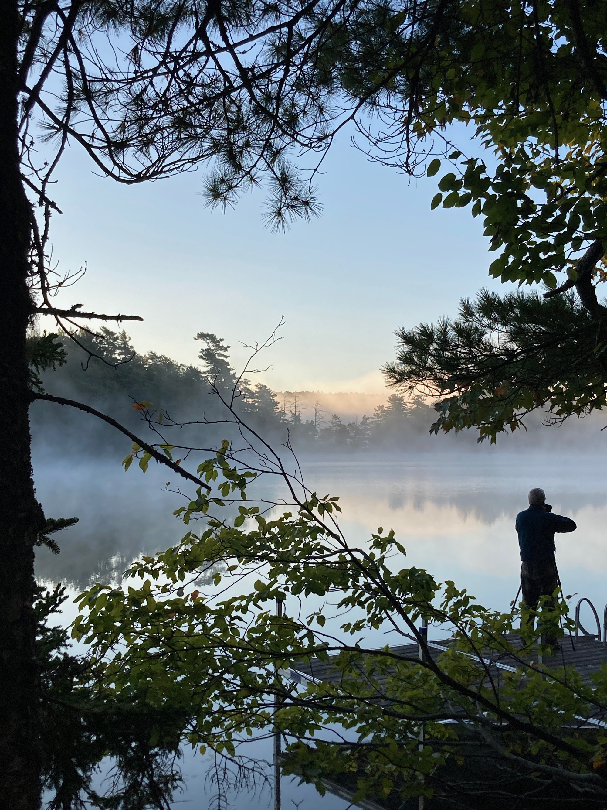

# About

I take great pleasure in exploring and photographing our world, particularly
nature: landscapes, wildlife and flowers. And also our "built environment."
Travels afar are a treat (Iceland! Scotland! Argentina! Brazil! And more!), but
close to home is a pleasure as well.

I've also done commissioned architectural photography; you'll find a
selection under [Architectural Photography](/architectural-photography/).

[One of my photos](/music/20220618-dsc8215-edit-2/) appears in W. Scott
Olsen's *[Reading Frames: Explorations in What Makes a Photograph Work](https://www.amazon.com/Reading-Frames-Explorations-Makes-Photograph/dp/1647692814/)*
(2026).

More photos, and the stories behind a few of them, are on my (somewhat
neglected) [blog](https://stevesickelsphotography.com).

If you're curious about some of my other interests, take a look at my other
website, [stevessite.com](https://www.stevessite.com).

I hope you enjoy my photos.

Steve Sickels

*Photo by my wife, Mount Desert Island, [Maine](/locations/maine/).*
