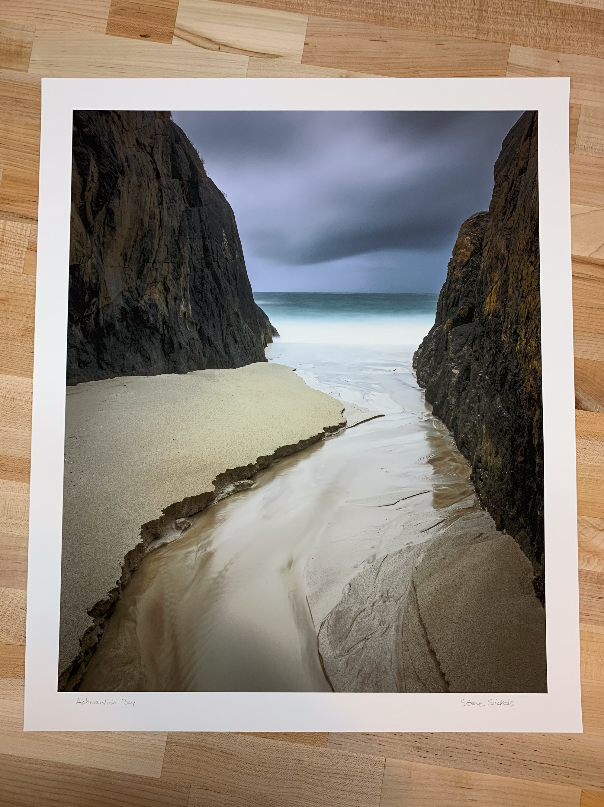

# Prints

Any photograph on this site can be made into a print. I make each one myself,
on archival papers with archival inks, at sizes up to 17″ × 22″, and I'm happy
to adjust things like size, cropping or borders to suit you.

I've made many prints on both matte papers (such as
[Hahnemühle Bamboo](https://www.hahnemuehle.com/en/digital-papers/fineart-collection/natural-line/p/Product/show/202/1036.html))
and glossy ones (such as
[Ilford Galerie Gold Fibre Gloss](https://ilfordusa.com/products/galerie-gold-fibre-gloss-310gsm-17mil)),
and I'd be glad to talk through which would suit you and the photos you're
interested in.

If you'd like a print, [send me a message](/contact/) saying which photo (a
link to its page is easiest) and roughly what size you have in mind. I'll get
back to you with options and a price.

*17″ × 22″ print on Hahnemühle Bamboo archival paper.
[Image](/locations/scotland/20161026-dsc01193-edit-2/) from [Scotland](/locations/scotland/).*
